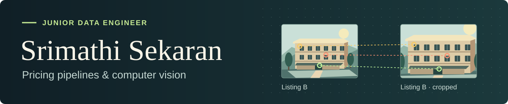

I’m a **Junior Data Engineer at Aggregate Intelligence** in Coimbatore, India. I build pipelines that help analysts compare prices and tools that recognize the same hotel across travel sites.

[Portfolio](https://srimathinithya.github.io/portfolio/) · [LinkedIn](https://www.linkedin.com/in/srimathi-sekaran-335179274) · [Email](mailto:csesrimathi@gmail.com)

## Selected code

| Project | Where to start |
| --- | --- |
| [Price volatility analysis](https://github.com/Srimathinithya/data-engineering-projects/tree/master/04-competitor-price-analytics) | The [SQL scorecard](https://github.com/Srimathinithya/data-engineering-projects/blob/master/04-competitor-price-analytics/schema.sql) compares hotel rates and ranks their volatility over a rolling seven-day window. |
| [Concurrent data ingestion](https://github.com/Srimathinithya/data-engineering-projects/tree/master/10-advanced-realtime-ingestion) | Follow a rate update through the [Python consumer](https://github.com/Srimathinithya/data-engineering-projects/blob/master/10-advanced-realtime-ingestion/consumer.py) to see how it checks for duplicates and batches MongoDB writes. |
| [Temporary database access](https://github.com/Srimathinithya/credential_management_system) | The [architecture guide](https://github.com/Srimathinithya/credential_management_system/blob/main/docs/architecture.md) follows a PostgreSQL access request from role approval to login expiry. |

[Browse all 10 data engineering and MLOps projects →](https://github.com/Srimathinithya/data-engineering-projects)

## Recent work

**Hotel identity and image matching**  
Different sites can list the same hotel under different names. I worked on a gradient boosting model that scores candidate records for review. I also built an OpenCV tool that spots identical photos by their SHA-256 hashes and verifies shared landmarks in cropped or resized images with SIFT and RANSAC.

**Self-storage pricing**  
A free first month can change which facility offers the lower rate. I worked on comparing similar units at nearby stores after accounting for promotions, and on preserving prior-day summaries in PostgreSQL so analysts can track price and inventory changes.

**Rental car delivery**  
A failed backup used to appear successful in Airflow. I fixed how the script reported errors, added delivery validation and heartbeat logging, and automated cleanup of expired records and output files.

<strong>Tools and experience</strong>

| Area | Tools I use |
| --- | --- |
| Pipelines and analytics | Python, SQL, pandas, Apache Spark, Apache Airflow |
| Record and image matching | scikit-learn, OpenCV |
| Databases and services | PostgreSQL, MongoDB, Redis, AWS S3, FastAPI |

I joined Aggregate Intelligence as an intern in October 2025 and moved into the Junior Data Engineer role in June 2026.

